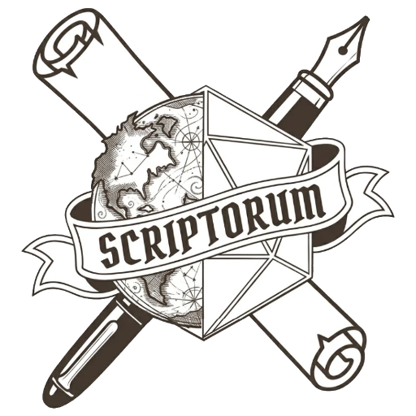

<p align="center"></p>

# Scriptorum
Note that this is a purely AI-written software, by human design and ideas. Since i needed something quick for a design, but liked the idea for others.

Scriptorum is a desktop text processor for game masters who write their own adventures. You write in formatted text, much like a word processor, with game elements such as scenes, read-aloud texts, people, clues, creatures, maps and handouts. Scriptorum turns it into pixel-perfect PDFs for printing: the adventure itself and the player handouts, built from the same text so they never drift apart.

- **Write once, use everywhere.** People, places, clues and creatures live in a codex and appear wherever they are used; renaming one updates every printed name.
- **Looks come from themes.** An adventure can change its look or page size without any change to its text. Version 1 brings the Vaesen game system and theme, a Plain game system and theme for any game, and two more themes.
- **Print-ready.** A live preview that matches the print, print-shop PDFs with bleed and crop marks, booklets, and accessible PDFs (PDF/UA).
- **Safe with your work.** Crash-safe saving, recovery copies, snapshots and undo. Adventures are single `.scav` files you can e-mail, back up or keep in Git.
- **Private.** No account, no tracking. Scriptorum is offline by default: with Block all connections outside the app on, it sends nothing to the internet. Turn it off in Settings to look for and download updates when you ask; every update is signed and checked before it is used.
- **Extensible.** Game systems, themes, languages and palettes are modules. How to write a theme and How to write a game system are in the Help menu. Extensions add functions with their own code: each shows what it needs before you install it, does nothing until you switch it on, and runs in a program of its own.

What each version brings is in the [changelog](CHANGELOG.md). The author guides, the API reference, the changelog and what is planned or waiting to be tested are also on the documentation website, [lyzio.github.io/Scriptorum](https://lyzio.github.io/Scriptorum/).

## Download

Installers are on the [releases page](https://github.com/lyzio/Scriptorum/releases):

| Platform | Download | Notes |
|---|---|---|
| Linux | `Scriptorum-<version>-linux-x86_64.AppImage` | Runs on mainstream distributions (glibc 2.35 or newer) without installing |
| macOS 12 or newer | `Scriptorum-<version>-macos-arm64.dmg` (Apple Silicon), `…-macos-x86_64.dmg` (Intel) | Unsigned: the first start asks for confirmation, see the install notes |
| Windows 10 or 11, 64-bit | `Scriptorum-<version>-windows-x64-setup.exe` | Tested with 0.6.9 and works; 0.7 not yet tried on Windows. Please report anything that does not work as an [issue](https://github.com/lyzio/Scriptorum/issues) |

Each download holds everything Scriptorum needs and works without an internet connection. The installers are not signed with paid Apple or Microsoft certificates; the install notes beside each download explain the first-start warning.

## Running from source

Python 3.11 to 3.13 (not 3.14 or newer) on Linux, macOS 12 or newer, or Windows 10 or newer.

```
pip install "PySide6==6.8.3" "typst==0.15.0" "spylls==0.1.7" "cryptography==48.0.1"
```
```
python -m scriptorum
```

Scriptorum keeps its own data (modules, recent files, recovery copies, snapshots, crash logs and installed updates) in `~/.local/share/scriptorum` on Linux, `~/Library/Application Support/Scriptorum` on macOS and `%APPDATA%\Scriptorum` on Windows. Running the tests, changing the interface, building installers and making releases are described in [docs/DEVELOPING.md](docs/DEVELOPING.md) and [packaging/README.md](packaging/README.md).

## Reporting a problem

Please open an [issue](https://github.com/lyzio/Scriptorum/issues) with what you did, what you expected and what happened. Crash logs stay on your computer, in the `logs` folder of Scriptorum's data folder; attach one only if you are happy to share it. Do not attach adventures or anything private: the repository is public.

## Built with

| Part | What it does | Licence |
|---|---|---|
| Python 3.13 | The core of the app | PSF |
| Qt 6.8 LTS with PySide6 6.8.3 | The window | LGPL 3 |
| Qt WebEngine (Chromium) | Hosts the interface, which is written in TypeScript | LGPL 3 and Chromium's licences |
| Typst 0.15.0 | Typesetting | Apache 2.0 |
| spylls 0.1.7 with Hunspell dictionaries | Spell check in Swedish and English | MPL 2.0; LGPL 3 (Swedish), MIT and BSD (English) |
| cryptography 48.0.1 | Checks the signatures on updates | Apache 2.0 or BSD |
| Cytoscape.js 3.34.0 | The relationship chart | MIT |
| Phosphor Icons 2.1.1 | Toolbar icons | MIT |
| fletcher, CeTZ, oxifmt | The printed relationship chart, inside the themes | MIT, LGPL 3, MIT-0 |
| Open fonts | Every font in the themes and the handwriting hands | SIL OFL 1.1, Apache 2.0 |
| Scriptorum logo | The logo, made with an AI image tool | CC BY-SA 4.0 |

Help ▸ About Scriptorum lists every part with its version and full licence text, and works offline.

## Licence

Scriptorum is free software under the GNU General Public License, version 3 or later (GPL-3.0-or-later); see [COPYING](COPYING). Every part it is built on is compatible with that licence. The logo was made with an AI image tool and is licensed CC BY-SA 4.0 ([docs/logo](docs/logo)). The themes named after published games are unofficial, fan-made looks, not affiliated with or endorsed by the owners of those games, and use no text, artwork or logos of theirs
